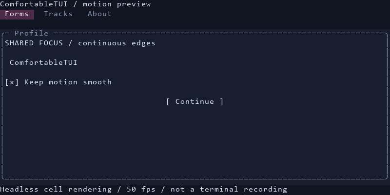

# ComfortableTUI

Version 0.1.5 reduces Windows overlay tracking delay with a translation-only path and consistent UIA calibration.

Spring-driven Python terminal interfaces, inspired by the 128×64 OLED UI in
[osu-mc](https://github.com/chhongzh/osu-mc). Includes a retained widget tree,
smooth scrolling and focus, animated page transitions, Unicode-aware cell
rendering, and an optional RGB pixel canvas using Kitty graphics.

Windows also has an optional **native overlay canvas**: external renderers write
shared image buffers, displayed in transparent owned windows with scaling and
mouse/keyboard/IME events. See the [canvas guide](docs/overlay-canvas.md).

Development branch: [GlassWorkspace](docs/glass-workspace.md) adds optional Windows
cards **around the terminal**, with native glass materials, spring-driven orbit/deck/
ribbon/focus layouts and existing CPU/shared-GPU canvas sources. Its controls use
our own C++/Direct2D UI; no WebView is started. See the [research and plan](docs/glass-research-plan.md)
and [standalone example](examples/glass_workspace/README.md). This feature is not in 0.1.5.

**Platform scope:** Linux graphical/WebView support is suspended. The former Qt
`WindowHost` was a separate application window, not an overlay in an existing
terminal. Linux terminal widgets and terminal-protocol pixel output remain available.
See the [Exa research and decision](docs/linux-support-decision.md).



The preview is an offline cell-frame illustration, not a terminal FPS recording.

Security: the browser service uses native origin/capability checks and default-denied
dangerous web permissions. Host Python, native extensions and frame providers remain
trusted; importing a plugin is not a sandbox. See the [security model](docs/security-model.md)
and [reporting policy](SECURITY.md). A matching rebuilt browser helper is required.

**状态：0.1.5 alpha。** 面向开发者的通用 TUI 库，Python 3.10+，支持 Windows、Linux、macOS
的 VT 终端。字符文字仍然受终端网格限制；像素画布在支持 Kitty graphics 的终端中可按像素移动。

```sh
python -m pip install -e .
python -m comfortable_tui
```

```python
from comfortable_tui import App, Button, Input, Label, Panel, VBox

message = Label("Hello / 你好", height=1)
name = Input(placeholder="Your name", height=1)
root = Panel(VBox(message, name,
                  Button("Greet", lambda: message.set_text(f"Hello, {name.text}!"), height=1),
                  gap=1), "First app")
with App(root) as app:
    app.run()
```

Tab / Shift+Tab changes focus, arrows navigate, Enter activates, Escape closes
dialogs or returns to a previous page, Ctrl+Q exits. Mouse click, wheel and
bracketed paste are supported. Enhanced keyboard terminals can activate on release.
F6 switches between the menu bar and its last focused content; Enter/Down enters
the selected page. The focused menu title shows a `›` marker and underline.

- [入门与安装](docs/getting-started.md)
- [原理调研与来源](docs/research.md)
- [Exa 调研：焦点与菜单动画优化](docs/motion-research.md)
- [Windows 原生缓冲区画布](docs/overlay-canvas.md)
- [Exa 调研：覆盖窗口与性能](docs/overlay-research.md)
- [Windows WebView 服务](docs/webview.md)（默认 CPU，可选 [GPU 纹理输出](docs/webview-gpu.md)）
- [Linux 图像混合模式暂停：调研与恢复条件](docs/linux-support-decision.md)
- [Exa 完整报告与计划：WebView 和跨平台附加层](docs/webview-research.md)
- [架构与动画](docs/architecture.md)
- [全部控件与交互](docs/widgets.md)
- [公共 API](docs/api.md)
- [终端协议与兼容性](docs/terminal-protocols.md)
- [性能、原生扩展与基准](docs/performance.md)
- [示例](examples/README.md)
- [测试、扩展和贡献](docs/development.md)

```sh
python -m pip install -e ".[dev]"
python -m pytest
python -m ruff check .
python examples/benchmark.py --frames 300
```

The default installation needs no compiler. An opt-in C++17 / pybind11 extension
scans dirty spans; see the performance guide for build commands and measured limits.
The core is an independent implementation. No osu-mc source or assets are bundled.
Licensed under the [Apache License, Version 2.0](LICENSE).
Copyright 2026 ComfortableTUI contributors. See [NOTICE](NOTICE).

Windows 画布现使用一个共享附加层显示多个逻辑画布，支持虚拟列表行、表格单元格与 Text 混排。运行 `python examples/embedded_canvas.py`，详见 [共享层调研](docs/shared-overlay-research.md) 和 [画布文档](docs/overlay-canvas.md)。

新增 [C++/GPU 数据平面](docs/native-gpu.md)：独立C++帧提供者SDK、D3D11跨进程共享
纹理与DirectComposition呈现，Python负责握手和控件控制。编译后运行
`python examples/gpu_canvas.py`；[调研与实测](docs/native-gpu-research.md)。
