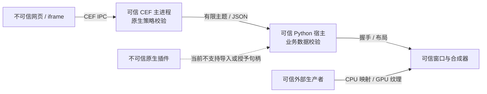

# 安全模型、实现与后续边界

2026-10-18。按能力分类建立边界，不在 Python 绘制路径叠加通用权限框架。
本轮封闭并验证的是宿主消息桥接与文中列出的 OSR 入口，不是完整浏览器产品或
不可信原生代码的通用沙箱。
本轮用 Exa 从 Electron、CEF、Tauri、OS 沙箱、网络资源五个方向请求 30 条候选，
再补查 4 条 Chromium API/特性来源。筛选上游文档与源码；原始结果在
`exa-results/security-2026-10-18/`。

## 安全承诺先限定主体

信任宿主应用的 Python、原生扩展和浏览器主进程；不信任网页、iframe、网页消息、
URL、终端文本和损坏的帧元数据。网页不能因为嵌入一个控件，就获得宿主的文件、
命令、窗口或图像通道权限。帧协议继续保持通用，业务桥接仍是独立上层服务。

**同进程第三方 Widget / pybind11 插件不是沙箱。** 它们与宿主一样可以调用 os、
ctypes、文件和网络。application_id、profile、消息分组、随机共享内存名都不构成
抵御恶意同用户进程的 OS 身份认证。此版本不支持把不可信 Python/C++ 插件装入
宿主后再用权限配置隔离它，也不把普通 subprocess 宣称为安全沙箱。

这与 [Tauri 明确区分核心代码和 WebView 的模型](https://v2.tauri.app/security/)
一致。其[能力文档](https://v2.tauri.app/security/capabilities/)也说明不能防御
恶意核心代码、过宽配置和未修复的 WebView 漏洞。



## 对标结果与设计取舍

| 来源 | 原则 | 本库对应措施 |
| --- | --- | --- |
| [Electron 安全清单](https://www.electronjs.org/docs/latest/tutorial/security) | 不向远程内容暴露系统 API；校验 IPC sender；限制导航和新窗口 | 网页只有 publish/subscribe，CEF 校验真实主 frame、精确 origin 和主题；没有 shell/fs RPC |
| [Chromium 沙箱设计](https://chromium.googlesource.com/chromium/src/+/main/docs/design/sandbox.md) | 低权限目标进程由可信 broker 代办能力 | 保留 CEF renderer 沙箱；禁止主服务用 no-sandbox / disable-web-security / 忽略证书 / 远程调试启动 |
| [Tauri capabilities](https://v2.tauri.app/security/capabilities/) | 无授权即无 IPC；能力按 WebView 限定，避免权限并集过宽 | 页面固定策略；子页面只能缩小服务的布尔权限和绑定初始 URL 后的 origin 上限 |
| [CEF 152 PermissionHandler](https://cef-builds.spotifycdn.com/docs/152.0/classCefPermissionHandler.html) | 嵌入者显式处理权限请求，不能依赖默认 UI 行为 | 设备/通用权限统一在 C++ 拒绝，不弹出可以被误点的系统授权 UI |
| [CEF ResourceRequestHandler](https://cef-builds.spotifycdn.com/docs/152.0/classCefResourceRequestHandler.html) | 资源、重定向、协议执行分别有入口 | 原生 URL-loader origin 检查、跨域重定向阻止、禁止 OS 协议执行 |
| [Windows AppContainer](https://learn.microsoft.com/en-us/windows/win32/secauthz/implementing-an-appcontainer) | SID、token、DACL 才是系统隔离边界 | 作为未来不可信生产者的必要条件；没有实装前不声称提供这种隔离 |

CEF 提供浏览器引擎和 renderer 沙箱，不会自动为我们的消息回调、宿主 Python、
Qt 窗口或外部生产者设计授权。CSP 是网页的脚本防线，不是宿主权限系统，也不能
代替原生校验。[Tauri CSP 文档](https://v2.tauri.app/security/csp/)同样建议限制资源
源而不是为了功能放宽 CSP。

## 逐类威胁与处理

| 类别 / 攻击 | 本轮落地 | 仍不承诺 |
| --- | --- | --- |
| 恶意网页调用宿主 | 原生主 frame + origin + topic + scope 检查；未知操作拒绝 | 宿主自行把 shell/文件操作挂在消息回调上仍需自己授权和校验 |
| 导航到钓鱼站、file/data/javascript | 初始 URL、显式 navigate、网页自行导航均受同一类原生 origin 规则约束 | 不为 file:// 或不透明 origin 提供兼容性授权 |
| 子资源窃取与重定向 | 默认初始 origin；额外资源源明确声明；重定向再次检查；无页面身份的后台请求拒绝 | 不是 OS 防火墙；不声称覆盖 WebSocket、WebRTC、DNS 等全部网络通道 |
| 权限提示、下载、上传文件、外部协议 | CEF 原生拒绝媒体与其统一 permission-prompt 权限、文件选择、下载、新窗口、外部协议、JS 对话框；不自动选客户端证书 | 尚未实现安全授权 UI，因此这些能力没有“允许”开关；不能把这些回调外推为所有 Chromium 设备 API 的 OS 封锁 |
| 打印、密码管理器与 Chrome UI | 在加载页面前设置并回读 Chromium 打印/密码/自动登录 pref；失败不加载内容；原生阻止非编辑 Chrome 命令，Linux 也取消打印回调；浏览器音频静音 | 不替代 OS 音量/凭据策略；WebAuthn、USB/HID 等未单独建立并验证的系统设备类不在本轮能力承诺内 |
| 剪贴板 / 用户输入 | 关闭 JS clipboard-access/dom-paste 设置，权限请求拒绝；宿主已有粘贴输入和保留快捷键继续工作 | 不声称 OS 级剪贴板封锁，也不把网页 API 设置等同于阻止可信宿主访问剪贴板 |
| 页面切换后权限残留 | 导航取消求值、清空订阅、递增文档代数；投递时再次核对真实当前 origin | JS 求值结果仍是网页提供的不可信数据，不能当认证或安全决策证明 |
| 消息洪泛和畸形 JSON | 原生 query 先做 120/s、突发 240 的准入，再解析；64KiB、32 层、4096 节点、64 订阅 | 不能限制网页自身 JS 堆；CEF 在路由回调前的内部消息内存不等于这个 64KiB 接受上限 |
| 控制管道超大无换行数据 | 两端有界读取；Python 严格 JSON 类型/非有限数检查，断开并回收故障 helper | 主 helper 本身仍是可信代码，协议号不是二进制身份认证 |
| 页面 / 帧内存耗尽 | 默认 16 页面、64 profile、每页三槽 64MiB、总三槽 256MiB；Python 计入待脱离旧帧，原生再校验当前帧 | 预算只管显式帧缓冲，不是 CEF 总 RSS / renderer JS / GPU 进程的 OS 配额 |
| 损坏的帧描述符 / 锁文件 | attach 前检查格式、类型、尺寸、步幅、大小；复制固定长度帧头后校验并使用该快照选槽位；POSIX 锁拒绝链接和宽权限文件 | 描述符持有者是可信生产者；CTUIFR01 的可写映射不是相互不信任的强隔离协议，恶意 truncate 等不在承诺内 |
| 日志撑满磁盘 | helper stderr 最多落盘 4MiB，之后继续排空；CEF 持久调试日志默认关闭 | 应用自己的日志、持久 profile 内容不受该 stderr 上限约束 |
| 原生插件、屏幕、窗口、任意系统调用 | 不对网页提供这些 API；现有原生插件和窗口宿主明确归为可信 | 未支持不可信原生插件，不能用 Python 审计钩子替代 OS 沙箱 |

“默认拒绝”针对框架向较低信任主体暴露的能力，不是限制应用作者自己的 Python。
浏览器类的所有新增决策在 C++ 的加载、导航、query 或权限入口完成；Python 不逐帧
查询权限，不把像素放进 JSON，不增加每个 Widget 一层授权对象。

媒体、通知、定位、非净化剪贴板访问、USB/HID/Serial/Bluetooth 请求 guard、文件系统
guard、字体、MIDI、键鼠锁、窗口管理和传感器使用已列明的 CEF ContentSetting 类型，
在首个真实文档加载前设为 BLOCK 并回读确认；同时撤销对应 origin 的旧设备选择数据。
只有拒绝 prompt 不足以覆盖旧 profile 的 ALLOW，因此还实测了持久化旧授权重启后
被覆盖，Cookie/localStorage 仍通过独立回归。每页导航 origin 上限 8、资源 origin
上限 64，使初始化时的 origin 组合检查有界，运行中不反复配置。

不能对所有 ContentSetting 枚举盲目设 BLOCK：CEF 152 的 CLIPBOARD_SANITIZED_WRITE
明确是 always-allow、无对应 pref 的特殊类型。标准净化写入仍遵守 Chromium 用户
手势规则，不在本轮“禁止所有剪贴板写入”的承诺中；没有用无效配置宣称已封禁。
USB/HID guard 的配置回读不是物理硬件攻击测试，WebAuthn 也尚无独立限制验证。

CEF renderer/utility 等子进程的 stdin/stdout 重定向到空设备；只有主 broker 使用
Python 的 JSON 控制端点。它们继续使用 CEF 自有 IPC，不把宿主控制管道当浏览器
子进程的标准输出。这不等同于对不可信插件完成全部句柄/FD 继承审计。

## 实际策略与 API

新增仅两个不可变的启动描述：BrowserPolicy 和 BrowserLimits。没有全局安全管理器、
动态角色继承、Python 中间件链或逐帧审计。策略在 open 时绑定、序列化一次；更改
需要重新创建页面。原生协议要求 security_protocol=1；旧 helper **拒绝启动**，
不能悄悄降级到未执行策略的运行时。该握手用于版本兼容，不是远程证明。

```python
from comfortable_tui import BrowserService, BrowserPolicy, BrowserLimits

policy = BrowserPolicy(
    navigation_origins=("https://app.example",),
    resource_origins=("https://app.example", "https://assets.example"),
)
with BrowserService("org.example.app", policy=policy,
                    limits=BrowserLimits(max_pages=8)) as browser:
    page = browser.open("https://app.example/dashboard",
        origins=("https://app.example",),
        publish_topics=("selection.changed",),
        subscribe_topics=("metrics.snapshot",))
```

origin 是 scheme/host/port 精确元组：[WHATWG origin 模型](https://html.spec.whatwg.org/multipage/browsers.html#origin)。
不支持通配符、前缀匹配、带路径授权、user:pass、反斜杠 authority、file/null origin。
授权和初始 URL 的主机只接受显式 ASCII/punycode，避免 Python IDNA2003 与 Chromium
UTS46 对 ß 等字符解释不同而授予另一个域名。Python 消除默认端口、拒绝混淆 IP 写法；C++ 用 CEF URL 解析
重新检查实际导航和授权值。非 loopback 的 HTTP 需要在服务中明确声明
allow_insecure_http=True；本机 127.0.0.1/localhost/::1 示例仍可直接使用。

navigation_origins 为空时固定为初始网络 origin；resource_origins 为空时继承导航
集合。origins 是桥接授权集合，必须是导航集合的子集，但导航许可本身**不会**
自动授予消息桥接。子 frame 永远不因这个列表直接获得桥接权限。相同 origin 的
脚本天然共享网页权限，不把同源 iframe 当作一个独立安全租户。

JavaScript 求值默认关闭。需要诊断的可信宿主可以在服务中明确设置
BrowserPolicy(allow_evaluate=True)，并且页面 origin 必须已授权。仍遵守 CSP，不
添加 unsafe-eval。求值结果只能作业务数据；恶意网页可修改 JS 全局对象、伪造
业务数据或不响应，不能把 evaluate("isAuthenticated") 当作宿主认证。

所有网页 query 共用上述单页 token bucket，包括诊断求值结果；被洪泛的页面的
求值可能超时，宿主控制管道的 close/cancel 不依赖这个 bucket。不会为了诊断 API
给网页留一个绕过限流的特殊消息前缀。

## Cookie、应用与页面联动

application_id 选择专用存储目录，profile 选择独立 CEF RequestContext；默认临时，
持久化显式启用。跨应用不共享 Cookie、localStorage、消息域。跨 profile 联动只有
宿主明确设置同一 message_group 才可发生。网页传来的 group/profile/scope 字段
不能替代宿主选择的 scope。目标 view 还必须处于同一 scope。

这些是应用内的逻辑隔离，不是抵御恶意本地同用户应用读取其他文件夹的能力。
宿主提供持久化 data_root 时应使用应用专属目录，而不是下载目录或文档根目录。
加密存储、OS 密钥链与专属 AppContainer 身份是下一阶段独立工作，不伪装成已经
由 application_id 实现。不要在日志中记录 Cookie、令牌、URL query 或消息正文。

## 如果未来需要允许危险能力

当前没有权限弹窗服务，危险能力统一拒绝。将来每增加一类能力，必须完成该类
所有入口和回收测试，不能先加 allow_camera / allow_shell 再补实现。

授权应是应用 manifest 上限 ∩ 当前页面策略 ∩ 用户真实操作后的单次/会话授权。
记录绑定 application、profile、page、实际 origin、文档代数、能力、范围和到期。
导航、关闭、撤销立即失效；不能接受网页自报 userGesture=True 或 trusted=True。

文件操作由可信 broker 打开用户选定的文件，仅向目标进程交付最小权限句柄；不把
任意路径字符串交给低信任插件。命令与外部协议只能从宿主固定业务操作中选择，
没有通用 run(cmd) / openExternal(url) 网页桥接。上传、下载、写文件和执行应分别
授权，不合成一个“访问电脑”权限。

授权 UI 必须属于可信窗口宿主，位于不受网页画布覆盖的区域；显示规范 origin 和
实际权限范围，不用网站 title 当身份。权限确认文案过滤终端控制字符和欺骗性双向
格式字符。WebView、GPU 画布不能绘制或拦截这个确认区。真正实现并验证之前，
保持危险能力无授权路径。

## 不可信提供者：独立阶段，未支持

Windows 先做独立低权限进程：AppContainer/LPAC、Job 对象的进程/内存/CPU 上限、
不继承任意句柄、专用身份与 DACL。仅由 broker 交付受限 CPU 映射或共享 GPU
资源句柄，校验适配器、尺寸、格式、slot 数量和生命周期。描述符不由网页指定。
文件、网络、设备、剪贴板、宿主 HWND 全部不继承；没有让网页请求加载 pybind11
模块的 API。句柄资源和 sandbox 兼容 GPU 的实测，是开放该类能力的前置条件。

Linux 使用独立 namespaces/seccomp/Landlock 等合适机制，最小只读根目录，显式
文件描述符传递，配额与超时。提供者不继承 DISPLAY、XAUTHORITY、Wayland 或 WSLg
桌面 socket；X11 客户端能力过大，不能把“换成独立 X11 进程”当作沙箱。只有
可信 WindowHost 与桌面通信。X11/Wayland 的功能测试不能替代这些隔离测试。

macOS 按既有范围暂不支持。上述 OS 方案目前是设计，不是当前 API 的能力声明。

## 性能门槛与验证方法

本轮实际结果见[安全验证与性能对照](validation/security/README.md)，包括原始 JSON、
复现步骤、未通过尝试的说明及性能限制。ComfortableTop 的 Windows GPU/CEF 对照中，
60 FPS 目标为 59.88 → 59.91，120 FPS 目标为 118.64 → 118.52；420 帧固定输入的
ANSI 输出逐字节等价，静止后的 90 帧输出为零。单次测量不能证明零开销。

- GPU 发布、keyed mutex、DirectComposition Present 不经过 Python ACL。CPU 帧只
  增加固定字段校验，没有逐像素检查。策略在创建/导航/请求/消息边界执行。
- query 先做轻量准入再解析；payload 遍历有节点/深度上限。仅限无像素的业务消息。
- 拒绝计数在原生累加，按需取诊断；不为每个拒绝请求写 URL/正文日志。
- 单元测试覆盖混淆 origin、策略越权、旧 helper、非法帧头、无换行超大 RPC、
  非法 JSON 类型、stderr 容量和 POSIX symlink。真实 CEF 通过原始 RPC 绕开 Python
  测试原生策略，还核对未授权请求确实没有到达第二个本地服务。
- 用 ComfortableTop 相同窗口尺寸、GPU/CEF 模式和持续采样，对比实际循环 FPS、
  间隔 P95/P99、tick/render/encode/write/overlay。另检查静态空闲差分仍为空。
  循环 FPS 不等于显示器呈现帧率，单机结果也不是跨设备性能保证。

复现原生安全检查：

```powershell
python -m pytest tests/test_security.py -q
python examples/verify_browser_security.py --browser PATH/ctui_browser.exe --report NEW.json
python examples/verify_webview.py --browser PATH/ctui_browser.exe --report OTHER-NEW.json
```

Linux 对两个实际图形会话分别传 --platform x11 和 --platform wayland；不能用
offscreen 代替。验证结果、性能对照和已知限制应随提交保存，不根据“编译通过”
就声称某个 OS 沙箱已启用。

## 维护与发布约束

源代码/运行时要作为匹配版本交付；helper 自报安全协议不能证明它没被本地替换。
由可信安装器检查发布哈希/签名、整套 CEF DLL 和资源，避免仅校验 bootstrap exe
而遗漏真正加载的 DLL。运行时路径和环境覆盖属于可信宿主配置，不是网页可写的
权限。应用不得从网页消息选择 executable 或 import 路径。

保持 CEF/Chromium 更新与漏洞响应；禁用沙箱、忽略 TLS 错误或开放远程调试不是
兼容方案。CSP 不兼容的测试应调整测试方式或显式诊断能力，不全局放开安全设置。
安全缺陷通过 SECURITY.md 的私下渠道报告，修复在真实原生入口做负面测试，并
通过功能和性能验证后才能把该能力标记为支持。
